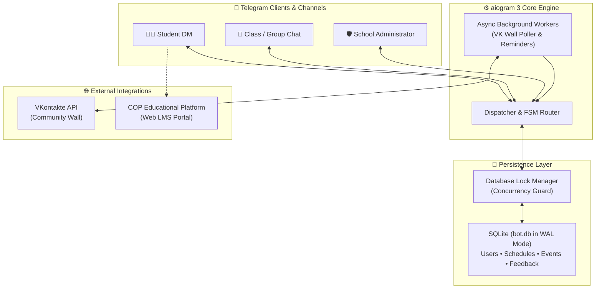
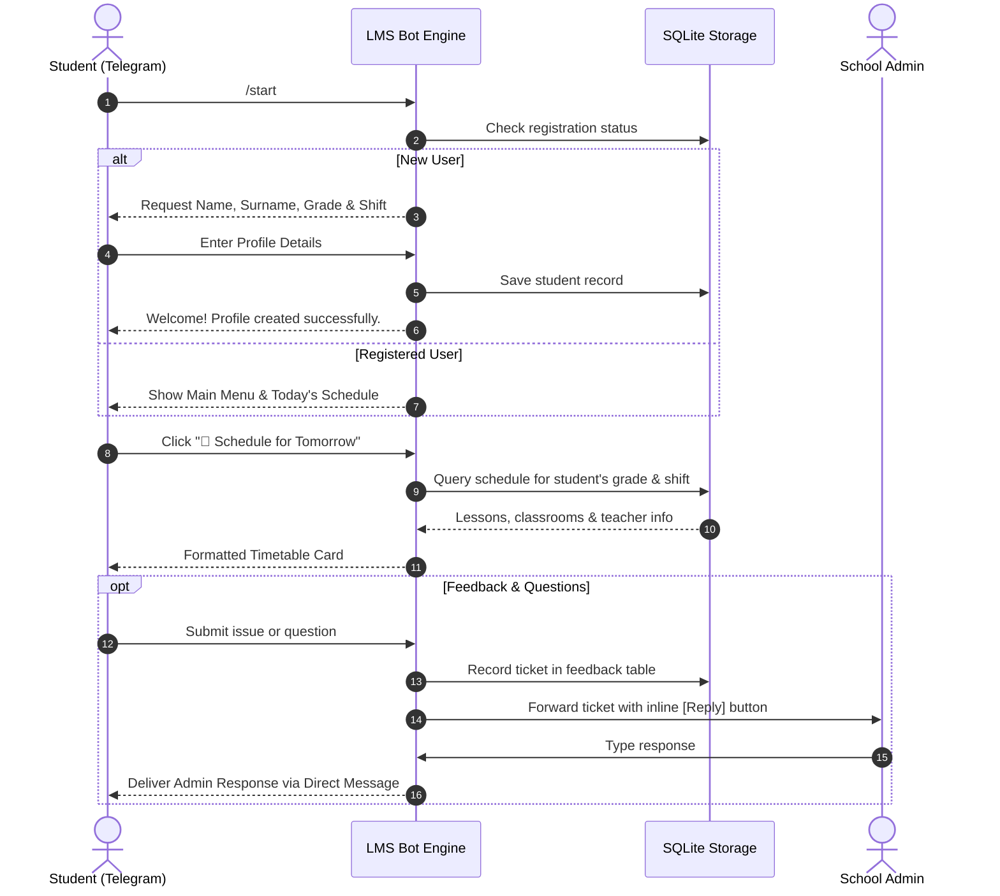

# 🎓 School LMS Telegram Bot • Школьный Telegram-бот

<div align="center">

[](https://www.python.org/)
[](https://docs.aiogram.dev/)
[](https://www.sqlite.org/)
[](https://www.docker.com/)
[](https://vk.com/dev)

**Интеллектуальная цифровая экосистема для школ, лицеев и колледжей: автоматизация расписания, рассылка объявлений, интеграция с ВК, календарь событий и обратная связь с администрацией.**

**[🇬🇧 English Version](#-english)** • **[🇷🇺 Русская версия](#-русский)**

</div>

---

<a name="-english"></a>
## 🇬🇧 English

### 📌 Overview
**School LMS Telegram Bot** is a high-load, asynchronous educational management platform built on **aiogram 3.x** and **SQLite (WAL Mode)**. Designed for primary and secondary educational institutions, colleges, and educational centers, the bot streamlines daily communication between school administration, teachers, students, and class groups.

---

### ✨ Core Feature Matrix

- **📅 Two-Shift Timetable Management**: Automated class schedule distribution supporting 1st and 2nd shifts, daily agendas (`/today`, `/tomorrow`), specific date lookups, and dedicated schedule admin controls.
- **📢 Rich Media Broadcasts**: Broadcast announcements to all registered students or specific grades/classes with attached photos, multi-media albums, and documents.
- **💬 Student Feedback & Help Desk**: Direct ticket submission from students to the administrative team with interactive inline buttons for immediate threaded responses.
- **📆 Event Calendar**: School calendar management with automated date parsing, reminders, and deadline alerts.
- **🔄 VKontakte Wall Auto-Syndication**: Background polling worker that automatically formats and mirrors posts from the school's official VK public page into Telegram student DMs and class group chats.
- **🎓 COP (Digital Educational Platform) SSO**: Integrated deep-links and quick authentication routing to regional digital educational platforms.
- **👥 Role-Based Access Control (RBAC)**: Fine-grained permissions separating regular Students, Schedule Administrators, and Super Administrators.

---

### 🗂️ Clean Layered Architecture

```text
LMS_BOT_PLS_100_BALLOW/
├── bot/                              # Основной модульный пакет бота
│   ├── core/                         # Ядро и инфраструктура
│   │   ├── config.py                 # Настройки, env и RBAC-роли
│   │   └── database.py               # Пул SQLite (WAL, замки, таймауты)
│   ├── database/                     # Репозитории данных (Data Access Layer)
│   │   ├── init.py                   # Централизованная инициализация таблиц и индексов
│   │   ├── users.py                  # Репозиторий пользователей
│   │   ├── schedule.py               # Репозиторий расписания и смен
│   │   ├── events.py                 # Репозиторий школьных событий
│   │   ├── feedback.py               # Репозиторий тикетов и ответов
│   │   └── groups.py                 # Репозиторий бесед и групп
│   ├── handlers/                     # Роутеры обработчиков (aiogram 3)
│   │   └── __init__.py               # Сборщик и регистрация роутеров
│   ├── keyboards/                    # Клавиатуры (Reply & Inline)
│   │   ├── reply.py                  # Главное меню, отмена, навигация
│   │   ├── events.py                 # Клавиатуры событий
│   │   ├── schedule.py               # Клавиатуры расписания
│   │   └── vk.py                     # Пагинация постов ВК
│   ├── states/                       # Конечные автоматы (FSM States)
│   │   └── fsm.py                    # Все FSM состояния
│   └── services/                     # Внешние интеграции и воркеры
│       └── vk_service.py             # Синхронизация постов ВКонтакте
├── data/                             # Хранилище SQLite БД (.gitkeep)
├── migrations/                       # Скрипты миграции БД
├── main.py                           # Главная точка входа
├── Dockerfile                        # Сборка контейнера
├── docker-compose.yml                # Оркестрация
├── requirements.txt                  # Зависимости
├── start.bat                         # Запуск для Windows
├── start.sh                          # Запуск для Linux/macOS
└── README.md                         # Документация
```

### 🏛️ System Architecture



---

### 🔄 Student Interaction Flow



---

### 🔑 Environment Variables Reference

Create a `.env` file in the project root based on `.env.example`:

| Variable | Description | Required | Default |
| :--- | :--- | :---: | :--- |
| `BOT_TOKEN` | Telegram Bot Token from [@BotFather](https://t.me/BotFather) | **Yes** | — |
| `FULL_ADMIN_IDS` | Comma-separated Telegram user IDs of Superadmins | **Yes** | — |
| `SCHEDULE_ADMIN_IDS` | Comma-separated IDs with schedule upload permissions | No | — |
| `VK_TOKEN` | VKontakte service or community access token | No | `""` |
| `VK_GROUP_ID` | Numeric VKontakte community ID for wall syncing | No | `171068837` |
| `DATABASE_PATH` | Relative or absolute path to SQLite file | No | `data/bot.db` |
| `TZ` | Timezone identifier for container scheduling | No | `Asia/Yekaterinburg` |

---

### 🚀 Quick Start & Installation

#### 1. Local Run
```bash
# Clone the repository
git clone https://github.com/airwar31/LMS_BOT_PLS_100_BALLOW.git
cd LMS_BOT_PLS_100_BALLOW

# Create and configure environment
cp .env.example .env
# Edit .env and insert your BOT_TOKEN!

# Install dependencies
python -m venv .venv
source .venv/bin/activate  # On Windows: .venv\Scripts\activate
pip install -r requirements.txt

# Run the bot
python main.py
```

#### 2. Docker & Docker Compose
```bash
docker compose up -d --build
```

---

<a name="-русский"></a>
## 🇷🇺 Русский

### 📌 Описание проекта
**Школьный Telegram-бот (LMS Bot)** — отказоустойчивый асинхронный сервис для автоматизации учебных процессов и информационного обмена в школах, гимназиях и колледжах. 

Бот решает ключевые задачи учебного заведения:
1. **Управление расписанием**: оперативная выгрузка уроков на две смены, просмотр на сегодня (`/today`), завтра (`/tomorrow`) и любую дату (`/schedule`).
2. **Оповещения и рассылки**: публикация новостей дирекции с фотографиями, медиа-группами и документами.
3. **Обратная связь**: единое окно вопросов учеников к администрации с ответами через встроенные инлайн-кнопки.
4. **Синхронизация с ВКонтакте**: автоматический репостинг новостей из школьной группы ВК в личные сообщения ученикам и классные чаты.
5. **Интеграция с ЦОП**: быстрый переход в Цифровую образовательную платформу.

---

### 📋 Список команд бота

| Команда | Описание | Доступ |
| :--- | :--- | :--- |
| `/start` | Запуск бота, регистрация профиля и главное меню | Все пользователи |
| `/help` | Подробная справка по возможностям бота | Все пользователи |
| `/today` | Расписание уроков на текущий день | Ученики и группы |
| `/tomorrow` | Расписание уроков на следующий учебный день | Ученики и группы |
| `/schedule [ГГГГ-ММ-ДД]` | Расписание на выбранную календарную дату | Ученики и группы |
| `/settings` | Настройки уведомлений и класса для групп | Администраторы бесед |
| `/toggle_vk` | Включение/отключение трансляции постов из ВК | Администраторы бесед |

---

### 🛡️ Безопасность и архитектура данных

- **Безопасность персональных данных**: База данных SQLite исключена из системы контроля версий Git. База создается и накатывает миграции автоматически при первом старте.
- **WAL-режим SQLite**: Обеспечивает параллельное чтение и запись без блокировок при высокой нагрузке во время утренних рассылок.
- **Graceful VK Fallback**: Если токен ВКонтакте не указан, бот продолжает стабильную работу без ошибок, отключая только модуль синхронизации стены.

---

### 📄 Авторские права / Copyright

Copyright (c) 2024-2026 Danila ([airwar31](https://github.com/airwar31)). Все права защищены / All rights reserved.
